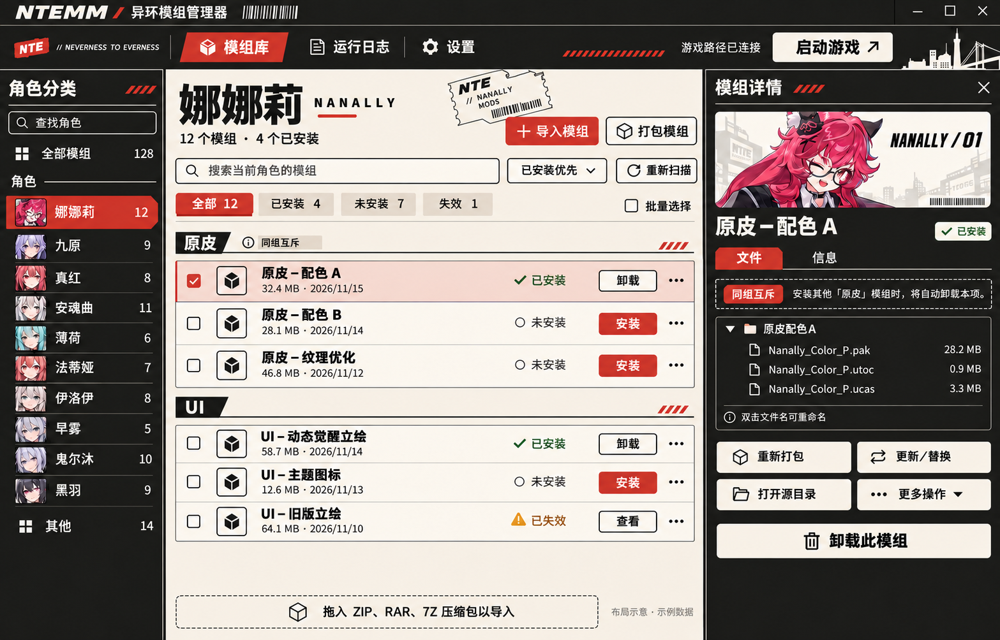
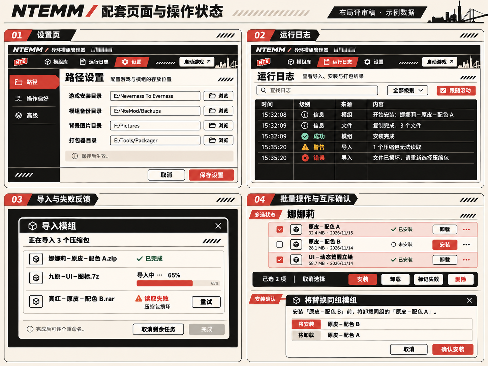

# NTEMM 界面重设计布局稿

日期：2026 年 11 月 16 日。

状态：用户已选定第一版三栏布局与暖白、朱红、墨黑配色。本稿继续用于视觉细节评审，图片中的名称、数量、大小、日期和日志均为示例数据。

本轮交付按选定布局与配色更新的主界面和配套页面。用户进一步要求去掉「背景展示」入口及全局底部信息栏，当前稿件按此精简。应用代码尚未改动，液态玻璃清理与界面实现属于后续实施阶段。

## 视觉方向

用户已选定「异环游戏感」以及第一版的左侧角色分类、中央模组列表、右侧模组详情三栏结构。

- 中央工作区采用暖白与米白，两侧面板及顶栏采用墨黑，强调色采用朱红。
- 基准色为暖白 `#F3EFE6`、米白 `#FFFCF6`、墨黑 `#20201E` 与朱红 `#CE3E35`。
- 面板为不透明实底，按钮和选中项使用硬边、切角和明确边框。
- 票据切口、编号、条码与环形图案用于边角装饰，正文区域保持清晰。
- 已安装、未安装、失效与进行中状态同时使用文字与图标区分。
- 布局稿使用项目现有娜娜莉头像作为视觉参考。其余 UI 图形为设计示意，不宣称已从当前游戏原版容器提取。
- 正式按钮切片与纹理图集在实施阶段按选定布局绘制并导出。

## 主界面

建议设计基准为约 1600 × 1000 的桌面窗口。图片为视觉稿，精确尺寸以落地时的布局约束为准。

| 区域 | 布局与用途 |
| --- | --- |
| 标题栏与全局导航 | 品牌、模组库、运行日志、设置、启动游戏及窗口控制。 |
| 左侧角色栏 | 全部模组、角色头像与名称、模组数量、其他分类。分类区独立滚动。 |
| 中央模组库 | 当前角色、模组数量、导入与打包、搜索、排序、重新扫描、状态筛选、分组列表。 |
| 右侧详情栏 | 所选模组、安装状态、互斥提示、文件树、源目录及重新打包等操作。 |

不设置全局底部信息栏。左侧角色区、中央列表和右侧详情区延伸到窗口底部；保留中央压缩包拖放提示。日志入口使用顶部「运行日志」，操作进度与失败原因显示在对应操作区域。

中央列表保留较高信息密度。每行显示名称、文件大小、导入时间、安装状态、操作按钮和更多菜单，不要求每个模组都有封面。

单击条目在右侧显示详情；复选框负责批量选择。安装和卸载采用明确动词，避免把状态标签作为唯一操作入口。

右侧详情栏可收起。窄窗口时以侧滑详情替代固定第三栏，优先保证模组名称、状态和安装按钮的可读性。

## 配套页面与操作状态

### 设置

采用完整工作区页面，左侧为设置分组，右侧为对应表单，底部固定显示取消和保存。

- 路径：游戏安装目录、模组备份目录、背景图片目录、打包器目录。
- 操作偏好：重新打包时复用上次的源文件夹、独占安装豁免分组。
- 高级：保留现有调试相关入口。
- 去除玻璃样式、玻璃参数及玻璃区域开关等全部相关选项。

移除「背景展示」分组入口；路径配置中的「背景图片目录」字段仍保留。

设置页中的现有字段按业务含义重新编排。新增分组名称与控件位置为本轮提案，不代表新增后台能力。

### 运行日志

延续同一外壳，主体为宽幅日志列表，时间、级别、来源和正文对齐。工具栏提供级别筛选、查找和跟随滚动，保留返回模组库的入口，不单设底部信息条。

### 导入

拖入压缩包或点击「导入模组」后，使用票据式对话框展示文件名、导入进度、结果和重命名入口。失败项提供清晰原因，并保留后续重试入口。

### 批量操作

多选后在列表底部出现操作栏，显示选中数量、安装、卸载、失效标记和删除等入口。失效安装与删除延续现有确认；互斥替换建议增加受影响模组说明与确认，具体方式待本轮评审。

### 其他状态

- 空分类：说明当前分类没有模组，提供导入入口。
- 搜索无结果：保留搜索词，提供清空筛选入口。
- 执行中：保留任务名称与进度，禁用冲突操作。
- 操作失败：在原上下文显示失败原因，并提供查看日志入口。
- 文件树：保留折叠与文件重命名；三件套重命名继续遵循现有业务规则。

## 评审重点

三栏结构与配色以用户选择为准。本轮继续检查字号、行距、选中状态、按钮形状与装饰贴图细节。设置页保存按钮、导入对话框操作按钮与批量操作条属于上下文操作控件，继续保留。

## 生成与验证

布局图由内置图像生成工具绘制。当前版本的配色与精简提示词见 [prompts-warm-white.md](./prompts-warm-white.md)，初稿提示词见 [prompts.md](./prompts.md)。

本轮仅新增设计交付物，没有启动应用、运行界面测试或打包程序；图片用于布局评审，不是已实现界面的运行截图。

## 历史方案

- [第一版原始主界面](./01-main.png)与[原始配套页面](./02-secondary.png)：用于保留最初的黑白荧光黄效果与布局来源。
- [未采用的横向布局研究稿](./variant-b/README.md)：深海军蓝、冰青与银白配色，采用横向角色栏和条目内联详情。
