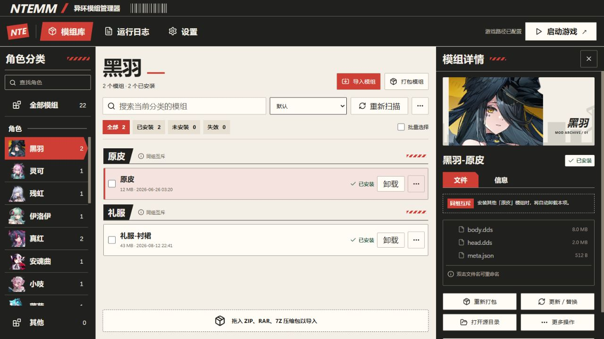
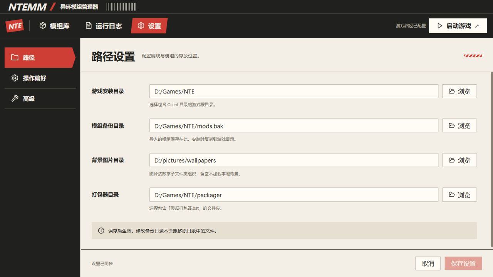

# 界面制作与验证记录

日期：2026 年 11 月 16 日。

实现提交：`70154af`。

已按用户确认的第一版三栏布局，以及暖白、朱红、墨黑配色实现界面。主界面去掉「背景展示」入口及全局底部信息栏。

## 已实现

- 顶部模组库、运行日志、设置、启动游戏导航，以及按需显示的任务进度。
- 可查找的角色分类栏，带头像与模组计数。
- 按名称查找、安装状态筛选、排序、重新扫描与分组列表。
- 可关闭的模组详情、文件与信息页签、文件树、内联文件重命名及完整模组操作。
- 条目复选与批量安装、卸载、重装、重新打包、失效标记及删除确认。
- 路径、操作偏好、高级三个设置工作区，以及未保存草稿的离开确认。
- 日志查找、级别筛选与跟随滚动。
- 导入结果列表、失败原因与重试入口，成功导入后继续进入逐项重命名。
- 城市剪影与票据 SVG 图形。角色头像沿用项目已有素材。

## 清理范围

移除应用的材质引擎、组件封装、依赖、类型定义、设置项及专用渲染开关。旧版配置节在保存设置时清理。图像轮播与识别服务保留原有业务边界。

第三方库源码未修改。任务开始前已有的角色配置更改与新增头像保留在工作区，不纳入本次提交。

## 验证

通过 `npm run dev` 启动，在用户授权的内置浏览器中验证。

| 检查 | 结果 |
| --- | --- |
| 主进程与网页类型检查 | `npm run typecheck` 通过。 |
| 角色切换与无结果状态筛选 | 通过。 |
| 单项安装、卸载与批量安装、卸载 | 内存 mock 通过，已恢复测试状态。 |
| 批量失效标记、取消标记与失效安装确认 | 内存 mock 通过。 |
| 文件重命名提交、取消与恢复原名 | 内存 mock 通过。 |
| 设置保存、重新进入、继续编辑与放弃未保存草稿 | 内存 mock 通过。 |
| 日志查找无结果 | 通过。 |
| 导入失败原因与重试入口 | 浏览器不支持真实解包的 mock 失败路径通过。 |
| 详情页签方向键切换 | 通过。 |
| 940 像素窗口宽度 | 详情侧滑显示，可收起，无横向溢出。 |
| 1568 像素窗口宽度 | 三栏显示，无横向溢出。 |
| 浏览器控制台 | 最终检查未发现错误或警告。 |
| 主界面材质画布与背景展示入口 | DOM 中画布数量为零，不显示背景展示入口。 |

浏览器测试使用内存 mock，不覆盖真实游戏目录的文件复制、实际压缩包解包、打包器执行或游戏启动。本轮未打包发布程序。

## 运行截图

以下是开发页运行截图，数据为内存 mock，不是图像生成稿。

