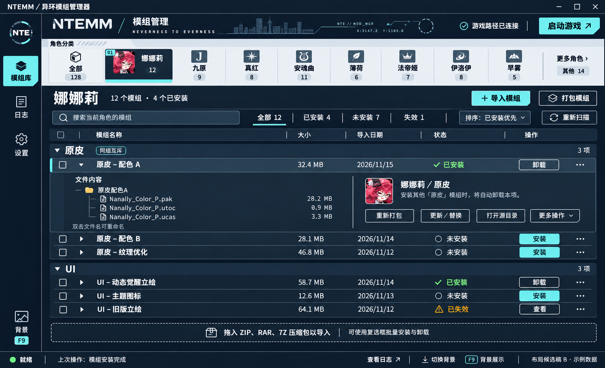

# NTEMM 第二版布局候选稿

历史方案：本布局未被采用。用户已选定第一版三栏布局与暖白、朱红、墨黑配色，并要求移除「背景展示」及全局底部信息栏。当前方案见[主设计说明](../README.md)。

日期：2026 年 11 月 16 日。

本版响应「换一个配色，再设计一版布局」。第一版黑白荧光黄方案保留，第二版独立归档供比较。

## 配色提案

采用深海军蓝、冰青与银白。此组颜色为候选配色，不代表用户已确认最终主题。

| 用途 | 色值 | 使用方式 |
| --- | --- | --- |
| 主背景 | `#0B1524` | 窗口与主要工作区底色。 |
| 内容表面 | `#15263A` | 列表、输入框和展开详情的层次区分。 |
| 强调色 | `#77E1E5` | 当前导航、主要操作和细线标记。 |
| 主文字与角色栏 | `#E6EDF2` | 正文高对比文字与横向角色选择区。 |

面板全部使用不透明实底。都市导视、票据、切角与编号作为少量装饰。

## 布局图

## 布局变化

- 全局导航收窄为左侧图标与短标签轨道，保留模组库、日志、设置和背景展示入口。
- 角色分类移至顶部横向选择栏，保留头像、名称与数量。「更多角色」可进入角色总览与查找。
- 模组列表使用主要工作区的完整宽度，为名称、大小、日期、状态和操作提供固定列。
- 文件详情在条目下方展开。复选框独立负责批量选择，避免展开详情与多选混淆。
- 导入、打包与启动游戏仍保持易于发现的位置。
- 底部集中呈现当前任务、日志入口和背景展示快捷键。

## 交互提案

列表默认保持紧凑，用户展开所需条目后就地查看文件树、重命名文件、重新打包、更新压缩包与打开源目录。窄窗口时，文件列表与操作区域在同一个展开区内上下排列。

角色横向栏可滚动。「全部」与「其他」保留独立入口；更多角色入口应提供名称查找，减少角色数量增加后的定位成本。

批量选择后，在底部显示选中数量及安装、卸载、重新打包、失效标记与删除入口。安装仍沿用已有的同组互斥业务规则，失效安装与删除延续必要的确认步骤。

背景展示保留 F9 入口。日常管理工作区使用实底，避免正文与背景争夺对比度。

## 交付边界

图片由内置图像生成工具绘制，用于布局评审。提示词见 [prompt.md](./prompt.md)。

图中名称、数量、日期、文件大小和状态均为示例。头像参考项目现有素材；图形细节为设计示意，不表示本轮已经提取游戏原版 UI 贴图。

本轮只新增设计交付物，尚未修改应用代码或删除液态玻璃实现，未进行应用界面测试。原先的工作区改动保持原样。

## 比较入口

[查看第一版布局稿](../README.md)。
